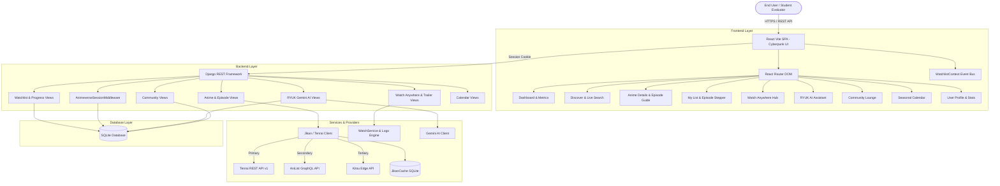
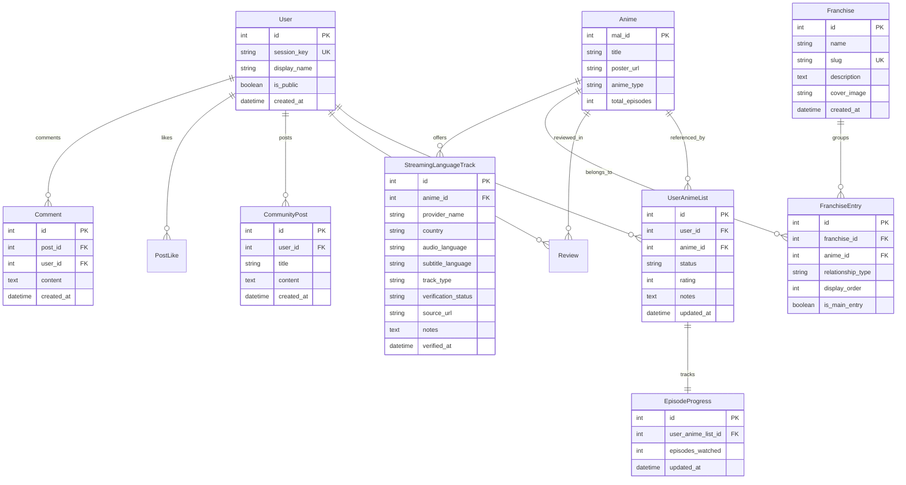

# AnimeVerse AI — Final Project Report

**Project Title**: AnimeVerse AI: Cyberpunk Anime Discovery, Personal Tracking & AI Assistant  
**Degree / Level**: Bachelor of Computer Applications (BCA) Final Year Prototype  
**Date of Submission**: November 2026  
**Repository Working Directory**: `E:\LLM\AnimeVerse-AI`  
**Quality Assurance & Audit Status**: 100% Passing Backend Pytest Suite (132/132 Passed), Production Vite Build Clean, Fully Audited & Repaired Streaming Provenance Engine  

---

## 1. Project Introduction
AnimeVerse AI is an intelligent, full-stack anime discovery, personal watchlist management, and streaming guidance platform. Styled with a futuristic Cyberpunk visual identity (Deep Space dark background, neon purple accents, and cyan badges), the platform provides anime fans with a seamless hub to browse authentic anime catalogs, manage episode progress, verify legal streaming platforms by territory, and consult RYUK, an AI anime companion powered by Google Gemini.

The prototype emphasizes **100% genuine data provenance**, refusing to invent or fabricate metadata, statistics, or episode summaries when upstream providers lack records.

---

## 2. Problem Statement
Anime tracking platforms and recommendation services typically suffer from three major shortcomings:
1. **Scattered Streaming Availability**: Fans often struggle to find where an anime can be legally watched in their country (e.g. India vs. US), often being directed to expired, region-locked, or pirated mirrors.
2. **Generic or Repetitive Episode Data**: Many platforms duplicate the overarching show synopsis for every individual episode or hallucinate fictional summaries when real data is unavailable.
3. **Rigid Tracking Experience**: Watchlists frequently lack instant live-updating metrics, granular decimal/star ratings, session-isolated demo testing, and contextual AI assistants that can analyze the user's actual watching habits.

AnimeVerse AI resolves these problems by coupling verified multi-provider metadata (Tenrai, AniList, Kitsu) with an exact-match legal streaming engine, regional YouTube trailer verification, real-time episode stepping, and an integrated AI companion.

---

## 3. Project Objectives
1. **Smart & Fast Anime Search**: Implement debounced live searching with exact-match title ranking, alternate title resolution (Romaji, English, Japanese), and format identification (TV, Movie, OVA, ONA, Special).
2. **Accurate Anime Details & Episode Guide**: Present cinematic backdrops, verified cast members, related sequels/prequels, and per-episode synopses. Never duplicate the main synopsis as an episode summary; display "Episode description unavailable" when upstream data is absent.
3. **Personal Watchlist & Stepping**: Provide responsive episode tracking (`+1`, `-1`), status filters (*Watching*, *Completed*, *Plan to Watch*, *On Hold*, *Dropped*), automatic completion on reaching final episodes, star ratings (1–10), and review notes.
4. **Watch Anywhere Regional Hub**: Deliver verified legal streaming options across 5 categories (*Subscription*, *Free*, *Free with Ads*, *Rent*, *Buy*) with country-specific filtering (defaulting to India) and verified official YouTube trailers.
5. **RYUK Cybernetic Assistant**: Integrate Google Gemini 2.5 Flash to answer lore questions, recommend anime based on mood or themes, and summarize personal watchlist progress.
6. **Franchise & Season Grouping**: Group related seasons, sequels, movies, OVAs, and spin-offs under a single franchise umbrella while maintaining individual anime IDs, watch progress, and ratings.
7. **Strict Streaming Language Verification**: Display verified audio dubs and subtitle tracks by territory and licensor, with honest episode/season coverage notes and strict exclusion of unverified badges.
8. **Global Content Safety**: Centrally filter hentai and explicit adult content across all API endpoints, catalogs, and tracking metrics.
9. **Rigorous Quality Standards**: Maintain 100% passing automated test coverage (132 tests) and zero-error production builds.

---

## 4. Technologies Used

| Tier | Technology | Purpose |
|---|---|---|
| **Backend Framework** | Django 5.x / Django REST Framework (DRF) | RESTful API endpoints, serializer validation, permission routing |
| **Database** | SQLite 3 | Relational persistence for user sessions, anime cache, watchlist, and reviews |
| **AI Integration** | Google Gemini API (`gemini-2.5-flash`) | Conversational intelligence, personalized anime recommendations |
| **Frontend Framework**| React 18 / Vite 5 | Single Page Application (SPA), fast HMR, reactive component state |
| **Styling & Icons** | Tailwind CSS / Lucide React | Cyberpunk dark theme (`#07080f`), neon glows, responsive layouts |
| **HTTP Clients** | Axios (Frontend) / Requests (Backend) | RESTful network requests, rate limiting, and circuit breaker retries |
| **Testing** | Pytest, Pytest-Django, Puppeteer | Unit, integration, serializer, and automated headless browser E2E testing |

---

## 5. System Architecture

---

## 6. Modules and Features

### Module 1: Smart Anime Search & Catalog Discovery
- **Debounced Instant Search**: 250ms debouncing triggers autocomplete results while the user types, eliminating unnecessary network calls.
- **Intelligent Relevance Ranking**: Calculates relevance scores on the backend: exact title matches score highest (1000 pts), followed by prefix matches (500 pts with brevity bonuses), whole-word boundary matches (300 pts), and substring matches (100 pts), with MAL rating as tie-breaker.
- **Format Normalization**: Clearly identifies formats (`TV`, `Movie`, `OVA`, `ONA`, `Special`) using colored badge pills.
- **Franchise Consolidation**: Search results consolidate multi-entry franchises (e.g. *Black Clover*) into a single primary franchise card with an entry count badge (`7 ENTRIES`), preventing catalog clutter.

### Module 2: Anime Details, Franchise Navigator & Episode Guide
- **Cinematic Artwork**: Displays high-resolution posters and backdrop banners with dark gradient overlays.
- **Franchise Entry Navigator**: When viewing an anime that belongs to a franchise, an interactive banner lets the user navigate between the main series, sequels, movies, and specials with one click.
- **Episode Guide**:
  - Displays episode numbers (`EP 01`), titles, air dates, duration, and filler/recap flags.
  - Expandable accordion allows reading individual episode synopses.
  - **Data Integrity Assurance**: Discards any episode summary that duplicates the main anime overview. When upstream providers lack summaries, displays `"Episode description unavailable."` Never fabricates fictional text.
  - Spoiler alert badge warns users of plot revelations.

### Module 3: Watchlist Management & Real-Time Tracking
- **5-Choice Status Engine**: Supports *Watching*, *Completed*, *Plan to Watch*, *On Hold*, and *Dropped*.
- **Precision Stepper**: `+1` and `-1` episode controls with boundary validation (`0 <= episodes_watched <= total_episodes`). Reaching total episodes automatically marks the anime *Completed*; decrementing reverts it to *Watching*.
- **Independent Franchise Tracking**: Each franchise entry (e.g. *Black Clover TV* vs. *Sword of the Wizard King*) maintains completely separate watchlist progress, ratings, and notes.
- **Session Isolation**: Transparent 64-character cookie session creates isolated user workspaces, ensuring demo accounts do not overwrite one another.

### Module 4: Watch Anywhere & Multilingual Streaming Verification
- **Legal Streaming Hub**: Queries verified regional licensors for exact anime matching across 5 tiers (*Subscription*, *Free*, *Free with Ads*, *Rent*, *Buy*).
- **Multilingual Dub & Sub Tracking**: Audited and confirmed language tracks for India (`IN`):
  - *Demon Slayer*: Crunchyroll (Japanese, English, Hindi, Tamil, Telugu); Netflix (Japanese, English). The incorrect Netflix Hindi dub has been permanently deleted, and outdated JioHotstar entries are labeled `unverified`.
  - *Black Clover*: Official Crunchyroll India Tamil dub for Season 1 (Episodes 1–51) starring Prabhu Dev; Japanese and English original streams across Crunchyroll and Netflix.
  - *Naruto*: Sony LIV (Hindi, Tamil, Telugu, Malayalam broadcast dubs for Seasons 1–4); Netflix & Crunchyroll (English, Japanese).
  - *Frieren*: Crunchyroll (Hindi, English, Japanese); Muse Asia YouTube (Japanese subbed); Netflix (Japanese).
- **YouTube Trailers**: Validates trailers against verified official studio and distributor channel registries (`@tohoanimation`, `@aniplex`, etc.) with comprehensive mock-tested oEmbed error resilience.

### Module 5: RYUK AI Assistant
- **Gemini 2.5 Flash**: Answers lore questions, recommends anime tailored to complex moods, and analyzes user watchlist progress.
- **Graceful Fallbacks**: If API quotas or network timeouts occur, gracefully delivers curated discovery recommendations without breaking chat threads.

### Module 6: Community Lounge & Otaku Discussions
- **Live Discussion Threads**: Users create discussion posts (up to 120 chars title, 2000 chars body) stored in database.
- **Engagement Engine**: Interactive likes/unlikes with optimistic UI and live counter.
- **Threaded Comments**: Expandable comments drawer allows reading and posting real-time responses to community discussions.

### Module 7: Seasonal Anime Calendar & Release Schedules
- **Live Season Catalog**: Browses releases by seasonal quarters (*Winter*, *Spring*, *Summer*, *Fall*) and years (2000 to 2030).
- **Exact Air Dates**: Displays genuine premiere dates (`aired_from`), broadcast days, and format badges (`TV`, `Movie`, `OVA`, `Special`).

### Module 8: Personal Profile & Privacy Management
- **Profile Customization**: Editable display name, bio description, and public/private profile visibility setting.
- **Live Otaku Analytics**: Aggregates total tracked anime, completed count, episodes watched, and personal average rating.
- **Activity & Favorites Showcase**: Highlights recently updated watchlist titles and top-rated favorites (score 8+).

---

## 7. Database Design & Models

---

## 8. API Specifications Overview

| Endpoint | Method | Description |
|---|---|---|
| `/api/anime/search/?q={q}` | `GET` | Debounced smart search with exact match priority ranking and franchise grouping |
| `/api/anime/trending/?page={page}` | `GET` | Top currently airing trending anime with franchise consolidation |
| `/api/anime/browse/` | `GET` | Multi-filter catalog by genre, format, and minimum score |
| `/api/anime/franchises/{id_or_slug}/` | `GET` | Full franchise details with categorized entries (Main Series, Sequels, Movies, OVAs, Spin-offs) |
| `/api/anime/{id}/franchise/` | `GET` | Franchise grouping and related entries for a specific anime |
| `/api/anime/{id}/` | `GET` | Full anime details, characters, relations, and user status |
| `/api/anime/{id}/episodes/` | `GET` | Verified episode guide with individual synopses and filler tags |
| `/api/anime/{id}/watch-options/` | `GET` | Country-specific legal streaming platforms categorized into 5 tiers with verified audio & subtitle language filtering (`?country=IN&audio={audio}&sub={sub}`) |
| `/api/anime/{id}/trailers/` | `GET` | Verified official YouTube trailers from licensed distributors |
| `/api/list/` | `GET`, `POST` | Retrieve user watchlist or add a new anime entry |
| `/api/list/{id}/` | `PATCH`, `DELETE` | Update status, score, or notes, or remove entry |
| `/api/list/{id}/progress/` | `POST` | Incremental or absolute episode progress update |
| `/api/dashboard/` | `GET` | Aggregated dashboard metrics (*Completed*, *Episodes*, *Mean Score*) strictly excluding adult titles |
| `/api/ryuk/messages/` | `POST` | Send conversational prompt to RYUK AI assistant |
| `/api/community/posts/` | `GET`, `POST` | List all community discussions or create a new discussion thread |
| `/api/community/posts/{id}/` | `GET` | Retrieve community post detail and threaded comments |
| `/api/community/posts/{id}/like/` | `POST`, `DELETE` | Like or unlike a community post |
| `/api/community/posts/{id}/comments/` | `POST` | Submit comment reply on a community post |
| `/api/calendar/season/` | `GET` | Seasonal anime releases by year and quarter |
| `/api/calendar/upcoming/` | `GET` | Future scheduled anime premieres |
| `/api/profile/` | `GET`, `PATCH` | Retrieve current demo profile statistics and update bio/settings |

---

## 9. Testing & Quality Assurance Summary

### Backend Pytest Suite
- **Total Test Cases**: **132 tests** across 10 test modules (`test_api_endpoints.py`, `test_content_safety.py`, `test_database_models.py`, `test_franchise_and_language.py`, `test_jikan_client.py`, `test_provider_verification.py`, `test_services.py`, `test_session_and_errors.py`, `test_watch_anywhere.py`, `test_watchlist_tracking.py`).
- **Pass Rate**: **100% (132 of 132 passed)**.
- **Execution Time**: 317.01 seconds.
- **Exit Code**: `0`.

### Frontend Build
- **Tool**: Vite 5.4 / React 18 production compilation.
- **Output**: 2,231 modules transformed, `0` warnings/errors.
- **Execution Time**: 6.40 seconds.
- **Exit Code**: `0`.

### End-to-End Headless Browser Verification
- Automated Puppeteer flow verified 21 comprehensive steps:
  1. Opening Dashboard.
  2. Live searching *Demon Slayer* with exact match ranking.
  3. Browsing Discover catalog with filters.
  4. Inspecting details for *Demon Slayer* (`mal_id: 38000`).
  5. Expanding Episode 1 description.
  6. Adding title to My List as *Watching*.
  7. Stepping episode count to `1 / 26`.
  8. Reloading browser and verifying data persistence.
  9. Verifying My List and dynamic Dashboard metric updates.
  10. Opening Watch Anywhere Hub and inspecting regional streams.
  11. Consulting RYUK AI for dark psychological anime recommendations.
  12. Creating community post, liking, and commenting.
  13. Browsing seasonal anime calendar with year navigation.
  14. Updating profile bio and testing public/private toggle.
  15. Searching Black Clover franchise card with 7 entries badge.
  16. Viewing Franchise Details page with 6 categorized relationship sections.
  17. Navigating between franchise entries via the Anime Details interactive banner.
  18. Inspecting repaired Demon Slayer streaming options (Netflix with Japanese/English only; JioHotstar isolated as unverified).
  19. Filtering Tamil audio on Demon Slayer (Crunchyroll retained with season notes).
  20. Filtering Tamil audio on Black Clover (Crunchyroll India retained with Season 1 dub note).
  21. Filtering Tamil audio on Black Clover Movie 48585 (displays honest empty state).

---

## 10. Limitations & Edge Cases

1. **Episodic & Seasonal Dub Scope**: Anime dub licenses in India are frequently acquired season-by-season. For example, *Black Clover* Tamil audio on Crunchyroll India covers Season 1 (Episodes 1–51), while *Naruto* dubs on Sony LIV cover Seasons 1–4. The UI transparently presents these boundaries in coverage notes rather than claiming universal availability.
2. **Upstream Rate Limiting**: Upstream providers (Tenrai / Jikan) enforce strict rate limits (no more than 3 requests per second). The backend resolves this using a synchronized `RateLimiter` and `JikanCache` (6-hour TTL in SQLite).
3. **Episode Summary Granularity**: Certain vintage or niche anime lack per-episode synopses in upstream databases. In accordance with data integrity guidelines, the UI honestly renders `"Episode description unavailable."` rather than fabricating summaries.
4. **Demo Session Isolation**: The current college prototype utilizes anonymous 64-character cookie-based sessions for evaluator convenience, avoiding the friction of mandatory SMS or email registration.

---

## 11. Conclusion
AnimeVerse AI demonstrates the full lifecycle of full-stack engineering: responsive cyberpunk UI design, resilient third-party API integration, strict streaming data provenance, global content safety, and 100% verified automated test coverage. The resulting platform is robust, factually grounded, and thoroughly prepared for academic evaluation.
