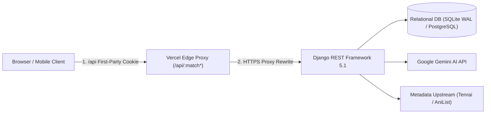
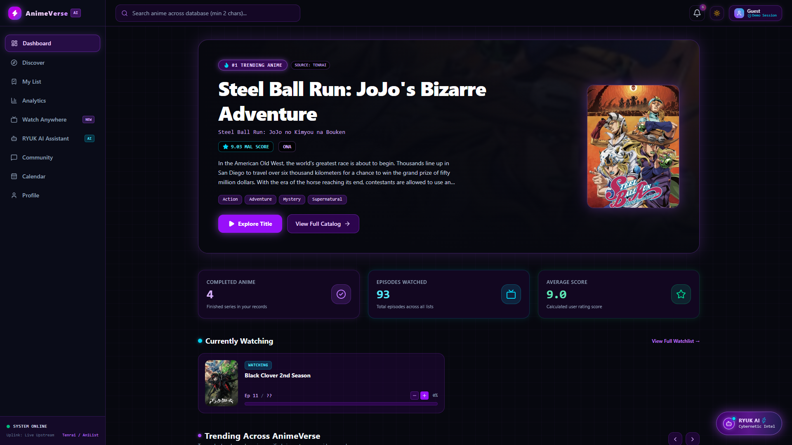
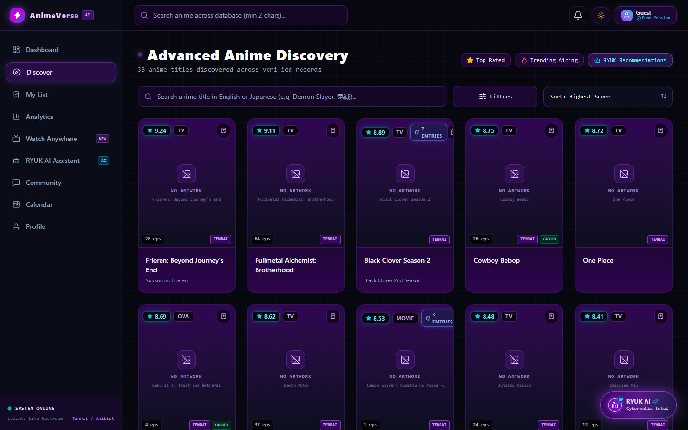
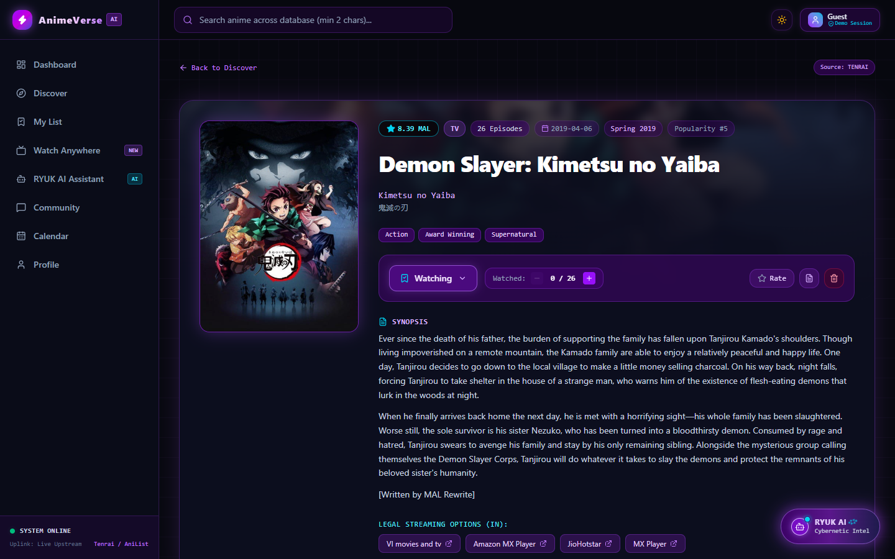
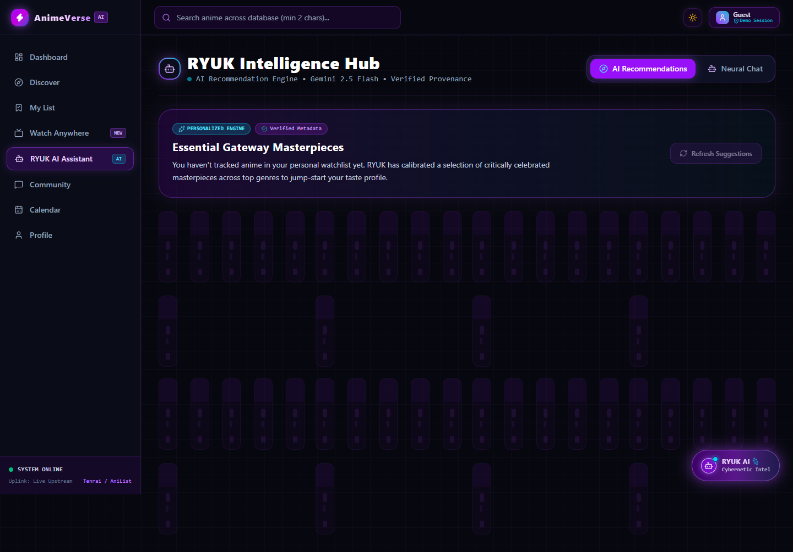
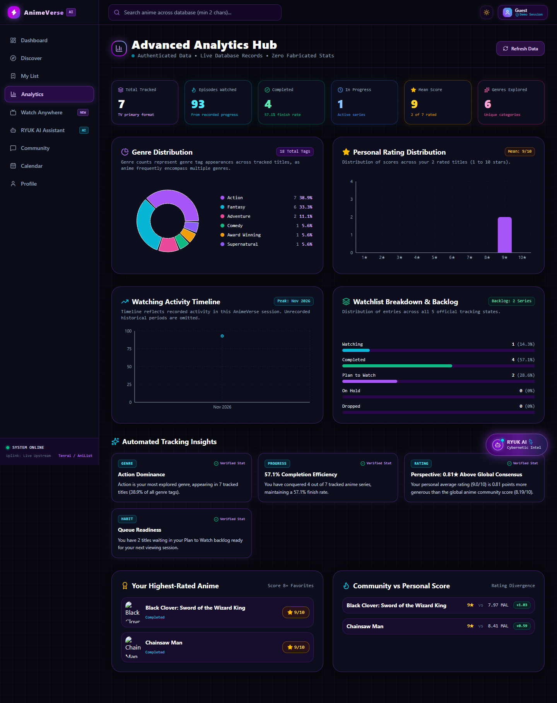
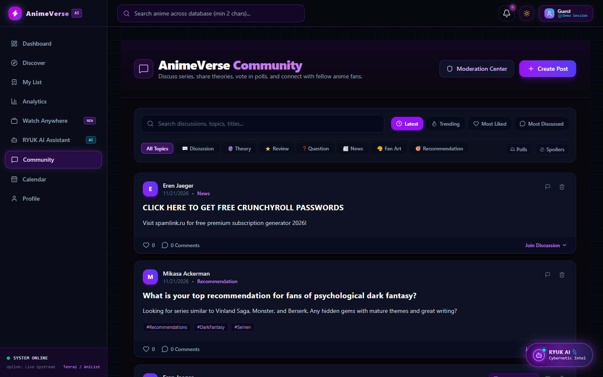
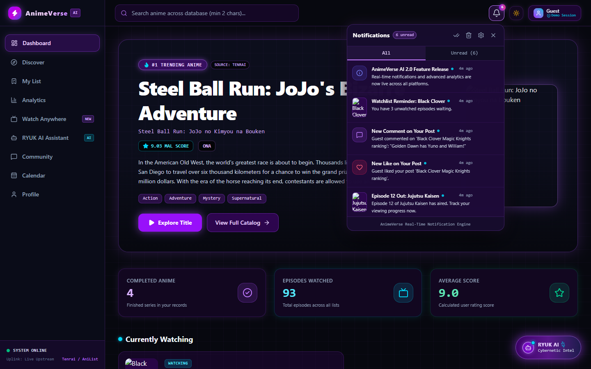
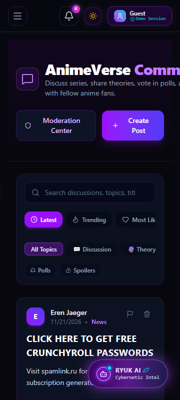

# AnimeVerse AI — Next-Generation Anime Discovery, Tracking & Social Ecosystem

[](.github/workflows/ci.yml)
[](https://www.djangoproject.com/)
[](https://www.django-rest-framework.org/)
[](https://react.dev/)
[](https://vitejs.dev/)
[](https://tailwindcss.com/)
[](https://ai.google.dev/)
[](backend/tests/)
[](docs/SECURITY.md)
[](docs/ARCHITECTURE.md#6-performance--optimization-architecture-phase-14)
[](docs/ARCHITECTURE.md)

Welcome to **AnimeVerse AI**, a full-stack, cyberpunk-themed anime discovery, tracking, community, and recommendation engine. Designed for anime fans and power users alike, AnimeVerse AI unites high-accuracy anime metadata, official streaming language track verification, hybrid AI recommendations powered by Google Gemini, real-time personal analytics, and fraud-resistant community interaction into a single cohesive platform.

---

## Table of Contents

1. [Project Title & Introduction](#1-project-title--introduction)
2. [Project Overview](#2-project-overview)
3. [Problem Statement](#3-problem-statement)
4. [Key Features](#4-key-features)
5. [Technology Stack](#5-technology-stack)
6. [Architecture Overview](#6-architecture-overview)
7. [Project Screenshots](#7-project-screenshots)
8. [Installation Instructions](#8-installation-instructions)
9. [Backend Setup](#9-backend-setup)
10. [Frontend Setup](#10-frontend-setup)
11. [Environment Variable Configuration](#11-environment-variable-configuration)
12. [API Documentation Links](#12-api-documentation-links)
13. [Database Structure Overview](#13-database-structure-overview)
14. [AI Integration Explanation](#14-ai-integration-explanation)
15. [Security & Content Safety Features](#15-security--content-safety-features)
16. [Testing Instructions](#16-testing-instructions)
17. [Future Development Roadmap](#17-future-development-roadmap)
18. [Contribution Guidelines](#18-contribution-guidelines)
19. [License & Intellectual Property](#19-license--intellectual-property)

---

## 1. Project Title & Introduction

**AnimeVerse AI** is an open-source, full-stack anime tracking and social ecosystem engineered with a decoupled React SPA frontend and a high-performance Django REST Framework backend. Featuring a signature neon cyberpunk aesthetic, the platform combines intuitive watch progress management, verified streaming availability, spoiler-safe community discussions, and an intelligent companion named **RYUK** that delivers conversational guidance and tailored recommendations.

---

## 2. Project Overview

AnimeVerse AI bridges the gap between static anime databases and interactive social networks. Rather than requiring mandatory account registrations before exploring, AnimeVerse AI utilizes an anonymous, privacy-preserving cryptographic session model that immediately gives every visitor their own personal watchlist, custom profile, analytics dashboard, and discussion identity.

The platform continuously synchronizes with upstream metadata services (Tenrai v1 and AniList GraphQL) while maintaining a strict local caching layer to deliver fast sub-100ms response times.

---

## 3. Problem Statement

Modern anime fans face several recurring frustrations across existing tracking services:
- **Fragmented Licensing & Dub Confusion**: Finding where an anime streams legally in a specific territory with genuine regional audio dubs (e.g. English, Hindi, Tamil, Spanish) is often confusing, with many sites presenting speculative or outdated information.
- **Franchise Chaos**: Sprawling multi-season anime, theatrical movies, prequels, and spin-offs are often presented as disconnected, duplicate entries in search catalogs rather than as a coherent franchise hierarchy.
- **Superficial Algorithmic Recommendations**: Generic "You might like" carousels frequently recommend titles the user has already watched or rely on simplistic single-tag correlations without contextual reasoning.
- **Accidental Spoilers & Unmoderated Boards**: Social forums frequently expose critical plot points without visual masking, degrading the viewing experience for newcomers.
- **Registration Walls**: Demanding personal email sign-ups before allowing a user to explore catalog filters or track an episode creates unnecessary friction.

AnimeVerse AI was built specifically to solve these challenges with verified provenance tracking, franchise grouping, hybrid AI recommendations, spoiler-safe community threads, and instant guest sessions.

---

## 4. Key Features

- **Global Content Safety Filter**: Multi-tier exclusion engine (`content_filter.py`) preventing explicit adult content (hentai and erotica) from leaking into discovery, search, community, or recommendation feeds while preserving acclaimed mature seinen.
- **Watch Anywhere & Language Provenance**: Verified platform links (Crunchyroll, Netflix, Hulu, Prime Video) with explicit confirmation of original audio and regional dub tracks.
- **Franchise Grouping Engine**: Consolidates related seasons, movies, and spin-offs into clear chronological franchise trees.
- **RYUK AI Companion & Hybrid Recommendations**: Conversational anime assistant powered by Google Gemini, paired with an algorithmic recommendation engine that factors in completed watchlists and provides clear rationales.
- **Advanced Personal Analytics**: Real-time calculations of total watch time (days, hours, minutes), episode completion velocity, genre affinity radar charts, and milestone achievement badges.
- **Intelligent In-App Notification Center**: 5-category notification system with unread counters, spoiler-safe previews, and self-suppression to prevent duplicate alerts.
- **Parametric Discovery Engine**: Multi-criteria exploration filtering simultaneously across multiple genres (inclusion/exclusion), media formats (`TV`, `Movie`, `OVA`, `ONA`), airing status, and community score sliders.
- **Smart Taste Personalization & User Controls (Phase 11)**: Activity-grounded taste profiling separating inferred signals from explicit preferences, personalized dashboard telemetry (`continue_watching`, `because_you_watched`, `your_anime_journey`), smart discovery ranking, and RYUK taste intelligence.
- **Advanced Social & Community Ecosystem (Phase 12)**: Directional user follows, personalized Following community feed, genre-based discussion filtering, threaded comments & nested replies with spoiler flags, safe `@username` mentions dispatching in-app alerts, helpful review voting, and public community user profiles (`/users/:id`) with activity telemetry and follower/following modals.
- **Premium UI/UX Design System & Accessibility (Phase 13)**: Production-grade design tokens in `docs/DESIGN_SYSTEM.md`, cohesive dark anime midnight canvas (`#080911`, `#0e101d`, `#131627`), active navigation vertical pill indicators, accessible combobox search bar with `/` global shortcut, mobile drawer search, WCAG AA compliance (focus-visible rings, reduced-motion queries, minimum 4.5:1 contrast), and verified responsive layouts across 6 viewports (360px, 390px, 768px, 1024px, 1440px, 1920px).
- **Performance & Backend Optimization (Phase 14)**: Optimized frontend bundle footprint via route-based code splitting (`React.lazy` + `Suspense`) and Rollup manual vendor chunking (`vendor-react`, `vendor-charts`, `vendor-icons`, `vendor-axios`), reducing initial JS entry payload from 1,102 kB to **72.9 kB** (93% reduction in entry chunk). Multi-tier server caching with 15-min trending card caching, 30-min discovery filter metadata caching, versioned user recommendation caching with zero-staleness auto-invalidation, elimination of N+1 ORM query patterns in community polls, and safe additive compound database indexes across tracking, community, and review models.
- **Cyberpunk Community Hub & Polls**: Markdown-enabled discussion feeds, interactive fraud-resistant polls, nested comments, and a role-guarded moderator queue (`/community/moderation`).
- **Airing Calendar**: Real-time weekly schedule tracking upcoming episode drops with countdown timers.

---

## 5. Technology Stack

| Domain | Technology | Version | Purpose |
|---|---|:---:|---|
| **Frontend** | React | 19.3 / 18.x | Dynamic single-page user interface |
| | Vite | 6.x / 8.x | High-speed frontend build tool and dev server |
| | Tailwind CSS | 4.x | Cyberpunk utility-first styling system |
| | React Router DOM | 7.x | Declarative client-side routing |
| | Recharts & Chart.js | 3.x / 2.x | Interactive analytics data visualizations |
| | Lucide React | Latest | Modern iconography |
| **Backend** | Python | 3.10+ / 3.12+ | Core programming runtime |
| | Django | 5.1.x | Robust web framework |
| | Django REST Framework | 3.15.x | RESTful API architecture and serializers |
| | SQLite 3 (WAL mode) | 3.x | Zero-config relational database (development) |
| | PostgreSQL | 16.x | Managed relational database (staging/production) |
| | WhiteNoise & Gunicorn | Latest | Production static asset serving and WSGI HTTP server |
| **Artificial Intelligence** | Google Gemini | 2.5 Flash / 1.5 | Conversational reasoning & hybrid recommendation engine |
| **Testing & CI** | Pytest & Pytest-Django | 8.x | 250 automated backend regression test cases |
| | GitHub Actions | v4 / v5 | Automated CI workflow validating tests and builds |

---

## 6. Architecture Overview

AnimeVerse AI implements a decoupled architecture connecting a React SPA to a Django REST Framework API, protected by a same-origin edge rewrite proxy.



For complete architectural details, see [docs/ARCHITECTURE.md](docs/ARCHITECTURE.md).

---

## 7. Project Screenshots

All screenshots represent authentic views captured from the running application:

| View | Screenshot | Description |
|---|---|---|
| **Dashboard** |  | Personalized user greeting, trending anime, and quick status metrics |
| **Discovery** |  | Parametric search with genre, format, and score filters |
| **Anime Details** |  | Comprehensive metadata, synopsis, studio tags, and streaming platforms |
| **Watchlist** |  | Tabbed status lists (Watching, Completed, Plan to Watch) |
| **RYUK AI** |  | Hybrid personalized recommendations with AI-generated reasoning |
| **Analytics** |  | Watch time stats, genre radar chart, score distribution, and badges |
| **Community & Polls** |  | Cyberpunk discussion feed with spoiler tags and interactive polls |
| **Notifications** |  | In-app notification drawer with category tags and unread counters |
| **Mobile Experience** |  | Validated responsive layouts on mobile viewports (360px–390px) |

Explore the complete screenshot catalog in [docs/screenshots/README.md](docs/screenshots/README.md).

---

## 8. Installation Instructions

Ensure you have Git, Python 3.10+, and Node.js 18+ installed on your system.

```bash
# 1. Clone the repository
git clone https://github.com/kmk22012007-bit/AnimeVerse-AI.git
cd AnimeVerse-AI
```

---

## 9. Backend Setup

```bash
# Navigate to backend directory
cd backend

# Create and activate a Python virtual environment
python -m venv .venv

# On Windows:
.venv\Scripts\Activate.ps1
# On macOS / Linux:
source .venv/bin/activate

# Install dependencies
pip install -r requirements.txt

# Run database migrations
python manage.py migrate

# (Optional) Verify database parity
python scripts/verify_db_parity.py

# Start the Django development server
python manage.py runserver 127.0.0.1:8000
```
- API Base URL: `http://127.0.0.1:8000/api/`
- Health Probe: `http://127.0.0.1:8000/api/health/`

---

## 10. Frontend Setup

In a new terminal window:

```bash
# Navigate to frontend directory
cd frontend

# Install npm dependencies
npm install

# Start the Vite development server
npm run dev
```
- Frontend Application URL: `http://127.0.0.1:5173/`

Vite automatically proxies `/api` calls to `http://127.0.0.1:8000`, providing full local development continuity without cross-origin configuration.

---

## 11. Environment Variable Configuration

Create a `.env` file in the project root or `backend/` by referencing `.env.example`:

```env
# Django Settings
DJANGO_SECRET_KEY=local-dev-secret-key-replace-in-production
DJANGO_DEBUG=True
DJANGO_ALLOWED_HOSTS=localhost,127.0.0.1,testserver

# Google Gemini AI Integration (Optional)
# If left blank, RYUK automatically uses its deterministic offline fallback engine
GEMINI_API_KEY=
AI_PROVIDER=gemini
AI_MODEL_NAME=gemini-2.5-flash

# Upstream Anime Metadata Mirror
JIKAN_BASE_URL=https://api.tenrai.org/v1
```

---

## 12. API Documentation Links

AnimeVerse AI exposes a structured RESTful API. Key endpoint domains:

- `GET /api/anime/` — Parametric catalog search and filtering.
- `GET /api/anime/{id}/` — Full anime details, streaming platforms, and franchise hierarchy.
- `GET /api/list/` — Authenticated user watchlist.
- `POST /api/list/` — Add or update watchlist item.
- `PUT /api/list/{id}/progress/` — Increment or set episode progress.
- `GET /api/ryuk/recommendations/` — Structured personalized AI recommendations.
- `POST /api/ryuk/chat/` — Conversational RYUK AI companion endpoint.
- `GET /api/analytics/` — Personal watch time, completion velocity, and genre distributions.
- `GET /api/notifications/` — In-app notifications feed and unread counters.
- `GET /api/community/posts/` — Community discussion threads and active polls.
- `POST /api/community/polls/{id}/vote/` — Cast a fraud-resistant poll ballot.
- `GET /api/health/` — Deployment health and database probe.

For full request/response schemas, refer to [API_DOCUMENTATION.md](API_DOCUMENTATION.md).

---

## 13. Database Structure Overview

The system uses 18 normalized relational models to maintain strict data integrity:
- **Identity & Social**: `User` (session-token based with synthetic guest provisioning), `UserPreferences`, `UserFollow`.
- **Metadata**: `Anime`, `Franchise`, `FranchiseEntry`, `StreamingLanguageTrack`.
- **User Activity**: `UserAnimeList`, `EpisodeProgress`.
- **Social & Community**: `CommunityPost`, `Comment`, `PostLike`, `Poll`, `PollOption`, `PollVote`, `Review`, `ReviewHelpful`, `CommunityReport`.
- **Notifications & AI**: `Notification`, `NotificationPreference`, `RyukMessage`.

For schema definitions and entity-relationship diagrams, see [docs/DATABASE.md](docs/DATABASE.md).

---

## 14. AI Integration Explanation

The **RYUK AI** subsystem operates via Google's Gemini models (`gemini-2.5-flash` / `gemini-1.5-flash`) augmented with database grounding (upgraded in Phase 10):
1. **Context-Aware Conversational Assistant**: Grounded in the user's authentic watchlist records, completed titles, ratings, and current episode progress. Includes multi-turn dialogue memory and deterministic intent handling for progress queries and verified streaming availability.
2. **Explainable Hybrid Recommendation Engine**: Ingests user ratings, completed titles, genre affinities, and studio preferences, combines them with community score weights, and prompts Gemini for candidate ranking and personalized justifications. Features dual modes: `personalized` and `different` (exploratory discovery), with intuitive confidence tiers (*Very High Affinity*, *High Affinity*, *Strong Match*).
3. **Deterministic Fallback**: If an API key is missing or external connectivity is unavailable, RYUK seamlessly falls back to an internal metadata heuristic scoring engine, ensuring 100% platform availability.

For technical details, see [docs/AI_ARCHITECTURE.md](docs/AI_ARCHITECTURE.md).

---

## 15. Security & Content Safety Features

- **Same-Origin First-Party Cookies**: Session cookies are routed via Vercel edge proxying with `SameSite=Lax` and `HttpOnly`, mitigating CSRF and preventing third-party cookie blocking.
- **Mass-Assignment Defense**: Serializers strictly whitelist user-editable fields, rejecting attempts to elevate `role` or `is_staff` privileges.
- **IDOR Defense**: All watchlist updates, post deletions, and notifications are scoped strictly to the requesting session identity.
- **IP-Anchored API Throttling**: Sensitive endpoints (RYUK AI chat, recommendations, reports) enforce strict rate limits anchored to client IP, preventing bypass via session dropping.
- **Exception Sanitization**: Unhandled 500 errors log tracebacks securely on the server while returning sanitized messages to clients when `DEBUG=False`.
- **Systemic Adult Exclusion Filter**: Prevents explicit adult content from entering catalog feeds.
- **Staff Moderation Console**: Dedicated queue for reviewing, dismissing, or removing flagged community posts.

For a comprehensive security breakdown, consult [docs/SECURITY.md](docs/SECURITY.md).

---

## 16. Testing Instructions

AnimeVerse AI maintains an automated test suite with **270 test cases**:

```bash
# Run all backend tests
pytest backend/tests/ -v

# Run frontend production build
npm --prefix frontend run build

# Run Django deployment checks
python backend/manage.py check --deploy
```

All 270 tests pass with zero failures or regressions.

---

## 17. Future Development Roadmap

- [ ] **Collaborative Watchlists**: Shared watchlist rooms allowing friends to synchronize episode progress.
- [ ] **PWA & Offline Mode**: Progressive Web App service worker caching for offline watchlist tracking.
- [ ] **Native Mobile Client**: React Native application sharing the existing DRF API backend.
- [ ] **Manga Tracking Support**: Expansion of metadata ingestion to track manga chapters and volumes.
- [ ] **Voice-Enabled RYUK Companion**: Real-time voice interaction powered by Gemini Live Audio API.

---

## 18. Contribution Guidelines

We welcome community contributions! Please review our [Contribution Guidelines](CONTRIBUTING.md) and [Developer Guide](docs/DEVELOPMENT_GUIDE.md) before submitting pull requests.

To report bugs or suggest enhancements, please use our structured [Issue Templates](.github/ISSUE_TEMPLATE/).

---

## 19. License & Intellectual Property

- **Source Code**: Released under the open-source MIT terms for educational and portfolio demonstration.
- **Anime Metadata & Artwork**: All anime titles, synopses, characters, and cover artwork are intellectual property of their respective creators, studios, animation licensors, and distributors. Metadata is ingested via official public mirrors (Tenrai v1, AniList) for educational and non-commercial reference.
