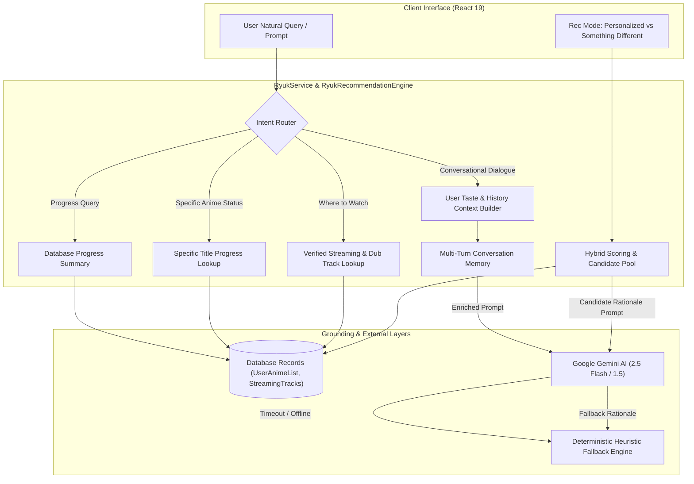

# AnimeVerse AI — RYUK AI & Recommendation Engine Architecture

This document provides a technical specification of the **RYUK AI** intelligent companion and personalized recommendation system in **AnimeVerse AI** (upgraded in Phase 10).

---

## 1. Architectural Overview

RYUK operates as a dual-capability intelligence layer:
1. **Context-Aware Conversational Companion**: A natural language assistant grounded in the authenticated user's actual watchlist records, verified metadata registries, and confirmed streaming tracks.
2. **Algorithmic Hybrid Recommendation Engine**: A structured REST API (`GET /api/ryuk/recommendations/`) delivering explainable recommendation cards backed by multi-signal scoring and dual exploration modes (`personalized` and `different`).

---

## 2. Context-Aware Grounding & Hallucination Defense

RYUK strictly distinguishes between:
- **Verified Database Records**: Watchlist status, watched episode count, user ratings, and official streaming audio tracks.
- **Verified Anime Metadata**: Total episodes, formats, studio names, and community scores.
- **AI-Generated Interpretations**: Story analysis, character comparisons, and thematic rationales.
- **Unavailable Information**: When an audio track or metadata field is unconfirmed in our database, RYUK explicitly states: *"Official streaming availability for that language/territory is not confirmed in our records."*

### Intent Routing Pipeline
1. **Deterministic Watch Summary**: Triggers on queries like `"Summarize my progress"` or `"How much anime have I watched"`. Computes exact completed, watching, and episode counts from database records without contacting external LLMs.
2. **Specific Anime Progress**: Triggers on `"What episode am I on for Demon Slayer?"` or `"Did I finish Death Note?"`. Matches the title against `UserAnimeList` and returns verified progress and ratings.
3. **Verified Streaming Guidance**: Triggers on `"Where can I watch [anime] in English/Hindi?"`. Inspects `StreamingLanguageTrack` and returns confirmed platforms and audio languages.
4. **Multi-Turn Conversational Memory**: In conversational mode, RYUK retrieves the previous 4-6 dialogue turns from `AIConversation.messages` so discussions remain coherent across turns.

---

## 3. Hybrid Recommendation Engine & Exploration Modes

The recommendation engine combines five scoring dimensions:

$$\text{FinalScore} = S_{\text{baseline}} + S_{\text{genre}} + S_{\text{studio}} + S_{\text{rating}} + S_{\text{mode}}$$

### Confidence Tiers
To avoid presenting heuristic match scores as scientific probabilities, scores are mapped to clear confidence tiers:
- **Very High Affinity** ($\ge 90\%$): Deep alignment across user top genres, favorite studios, and community acclaim.
- **High Affinity** ($83\% - 89\%$): Strong overlap with user preferences and positive ratings.
- **Strong Match** ($76\% - 82\%$): Recommended based on high community scores and matching secondary genres.
- **Curated Match** ($< 76\%$): Gateway titles calibrated for broad appeal.

### Dual Recommendation Modes
1. **`mode='personalized'`**: Prioritizes the user's highest-rated genres, related anime franchises, and favorite animation studios (e.g. Ufotable, Bones, Mappa, Madhouse).
2. **`mode='different'` (Serendipitous Discovery)**: Identifies underrepresented genres the user has not heavily explored and recommends acclaimed ($8.0+/10$) masterpieces from those genres to broaden viewing horizons.

---

## 4. API Endpoints Specification

| Method | Endpoint | Description |
|---|---|---|
| `POST` | `/api/ryuk/messages/` | Send message to RYUK with conversation memory and grounded intent detection. |
| `GET` | `/api/ryuk/recommendations/` | Retrieve personalized or exploratory recommendations with confidence tiers. |
| `GET` | `/api/ryuk/conversations/` | List past conversation sessions for the authenticated user. |
| `GET` | `/api/ryuk/conversations/{id}/messages/` | Retrieve message history for a specific conversation. |
| `DELETE`| `/api/ryuk/conversations/{id}/` | Delete a specific conversation (protected by IDOR validation). |
| `POST` | `/api/ryuk/conversations/clear/` | Purge all conversation history for the authenticated user. |

---

## 5. Security & Privacy Architecture

- **Zero Client Credential Exposure**: Gemini API keys reside exclusively in backend environment variables (`GEMINI_API_KEY`).
- **Privacy-Preserving Prompts**: Context sent to external LLMs contains only anime titles, ratings, and genres—never email addresses, IP addresses, or personal identifiers.
- **IDOR Protection**: All conversation management endpoints enforce `user=request.animeverse_user`, returning `404 Not Found` if a user attempts to access or delete another user's dialogue.
- **Adult Content Sanitization**: Candidate pools, prompt contexts, and chat suggestions are filtered through `content_filter.py` to prevent adult/NSFW content leakage.
