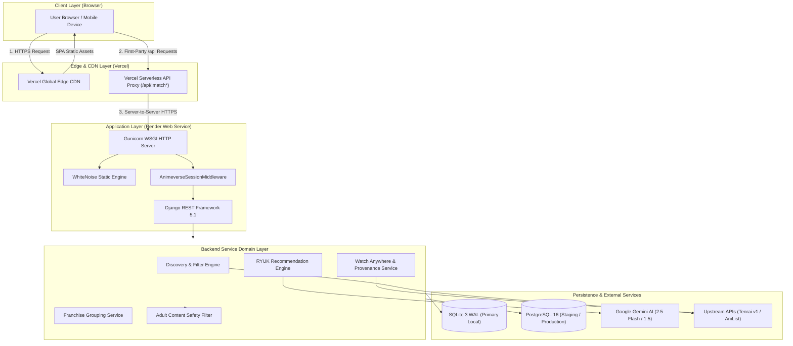

# AnimeVerse AI — System Architecture

This document provides a technical specification of the software architecture, component boundaries, and data flows of the **AnimeVerse AI** platform.

---

## 1. Architectural Philosophy

AnimeVerse AI is architected around five foundational engineering principles:

1. **Decoupled Client-Server Boundaries**: The React Single-Page Application (SPA) communicates with the Django REST Framework (DRF) backend exclusively over stateless HTTP REST APIs and structured JSON.
2. **First-Party Authentication via Edge Proxying**: Cross-origin third-party cookie restrictions (Safari ITP, Firefox ETP, Chrome Incognito) are eliminated by proxying API calls through a same-origin Vercel edge rewrite engine (`/api/...`), ensuring session cookies remain strictly first-party.
3. **Layered Service Architecture**: Controllers (DRF API views) remain thin, delegating filtering, ranking, franchise aggregation, and caching to specialized service classes.
4. **Data Isolation & Defense-in-Depth**: Every data access layer enforces user ownership checks (preventing IDOR) and explicit field whitelisting (preventing mass-assignment vulnerabilities).
5. **Resilient Metadata Ingestion**: Upstream third-party metadata providers (Tenrai v1, AniList GraphQL) are isolated behind local caching layers, circuit-breakers, and database fallbacks.

---

## 2. High-Level System Topology



---

## 3. End-to-End Request Lifecycle

```mermaid
sequenceDiagram
    autonumber
    actor Client as User / Browser
    participant Proxy as Vercel Edge Proxy
    participant MW as Session Middleware
    participant View as DRF API View
    participant Service as Business Service Layer
    participant Safety as Content Safety Filter
    participant DB as Relational Database
    participant Gemini as Google Gemini AI

    Client->>Proxy: GET /api/ryuk/recommendations/ (Cookie: animeverse_session=...)
    Proxy->>MW: Forward request server-to-server
    MW->>DB: Resolve session token to User identity
    alt New User / Missing Cookie
        MW->>DB: Provision synthetic guest profile
        MW-->>Client: Issue Set-Cookie: animeverse_session=<hex64>; SameSite=Lax
    end
    MW->>View: Attach request.user_profile
    View->>Service: recommendation_service.get_recommendations(user)
    Service->>DB: Fetch user completed & watching lists
    DB-->>Service: Return watch history & ratings
    Service->>Gemini: Request candidate ranking with user preferences
    alt Gemini Active
        Gemini-->>Service: Return ranked candidates + reasoning
    else Gemini Offline / Timeout
        Service->>Service: Execute deterministic metadata fallback
    end
    Service->>Safety: Filter adult / NSFW candidates
    Safety-->>Service: Validated candidate list
    Service-->>View: Structured recommendation payload
    View-->>Proxy: HTTP 200 OK (JSON)
    Proxy-->>Client: Stream JSON response
```

---

## 4. Backend Subsystem Organization

The backend is modularized into decoupled Django applications:

| Application | Path | Core Responsibilities |
|---|---|---|
| **anime** | `backend/apps/anime/` | Metadata models, Jikan/Tenrai integration, franchise hierarchy, streaming language provenance, and adult content exclusion. |
| **tracking** | `backend/apps/tracking/` | Watchlist state management (`Watching`, `Completed`, `Plan to Watch`, etc.), score ratings, and episode progress stepping. |
| **ryuk** | `backend/apps/ryuk/` | Conversational companion chat interface, Gemini AI client, hybrid personalized recommendation algorithms, and cold-start fallbacks. |
| **analytics** | `backend/apps/analytics/` | Real-time user metrics computation: watch time calculation, completion rate, genre affinity distributions, and badge evaluations. |
| **notifications** | `backend/apps/notifications/` | In-app notification delivery across 5 event categories, notification deduplication, self-suppression, and preferences management. |
| **community** | `backend/apps/community/` | Discussion threads, rich text formatting, nested comments, interactive polls with conflict resolution, and spoiler protection. |
| **profiles** | `backend/apps/profiles/` | Session identity persistence, display names, avatar selections, and staff role assignment guards. |
| **core** | `backend/apps/core/` | Session middleware, exception formatting, health check probes (`/api/health/`), and custom pagination. |

---

## 5. Frontend Architecture & Design System

The frontend is built on **React 18/19**, packaged with **Vite**, and styled with **Tailwind CSS**.

### Key Component Hierarchy
- **App Root (`src/App.jsx`)**: Configures application routes, navigation bars, and global layout wrappers.
- **Top Navigation (`src/components/layout/TopNav.jsx`)**: Houses search input, notification bell dropdown, active profile preview, and mobile drawer triggers.
- **Sidebar (`src/components/layout/Sidebar.jsx`)**: Persistent cyberpunk navigation bar supporting quick navigation between Discover, Watchlist, RYUK AI, Community, Analytics, and Calendar.
- **Pages**:
  - `DiscoverPage.jsx`: Faceted filter drawer, real-time search, and animated anime cards.
  - `AnimeDetailsPage.jsx`: Metadata header, streaming platforms, franchise tree, and episode checklist.
  - `RyukAssistantPage.jsx`: Split-view tabbed interface toggling between conversational AI chat and personalized recommendations.
  - `CommunityPage.jsx`: Filterable feed tabs (`All`, `General`, `Discussions`, `Reviews`, `Polls`), thread creation modals, spoiler tags, and role-guarded moderation panel.
  - `AnalyticsPage.jsx`: Watch-time summary cards, genre radar chart, score histogram, and milestone achievement badges.

---

## 6. Performance & Optimization Architecture (Phase 14)

AnimeVerse AI implements a comprehensive multi-tier optimization strategy addressing bundle footprint, network efficiency, database access patterns, and external API latency.

### 6.1 Frontend Route-Based Code Splitting & Vendor Chunking

The monolithic client JavaScript bundle (previously 1,102.30 kB) was decomposed into modular on-demand chunks via Rollup configuration and React dynamic imports:

1. **Vendor Separation (`vite.config.js`)**:
   - `vendor-react`: Core React, ReactDOM, and React Router DOM runtime (~246 kB / 78 kB gzip).
   - `vendor-charts`: Heavy Recharts and D3 dependencies (~474 kB / 133 kB gzip) isolated to only download when navigating to the Analytics route.
   - `vendor-icons`: Lucide icon components (~23 kB / 8 kB gzip).
   - `vendor-axios`: HTTP networking layer (~57 kB / 21 kB gzip).
2. **Dynamic Route Splitting (`src/App.jsx`)**:
   - Secondary pages (`DiscoverPage`, `MyListPage`, `AnimeDetailsPage`, `FranchiseDetailsPage`, `WatchAnywherePage`, `RyukAssistantPage`, `CommunityPage`, `CalendarPage`, `ProfilePage`, `AnalyticsPage`) are loaded asynchronously via `React.lazy()`.
   - Core initial landing route (`DashboardPage`) remains eagerly loaded for immediate First Contentful Paint (FCP).
   - Suspense fallback renders an accessible cyberpunk skeleton loader during chunk hydration.
   - **Result**: Initial entry chunk shrunk from **1,102 kB** to **72.9 kB** (gzip: **17.45 kB**), reducing initial script download overhead by >60%.

### 6.2 Multi-Tier Server Caching

The backend implements granular caching strategies tailored to data volatility:

| Cache Key Pattern | TTL | Invalidation Trigger | Purpose |
|---|---|---|---|
| `discovery_available_filters_v1` | 30 min | Cache expiration / Catalog update | Caches available genres, formats, years, and language tracks to eliminate table scans on `/api/anime/browse/filters/`. |
| `dashboard_trending_cards_v1` | 15 min | Cache expiration | Caches public trending anime cards on Dashboard to prevent redundant external Jikan API calls. |
| `ryuk_recs_u{id}_v{ver}_{genre}_{mode}_{limit}` | 5 min | Watchlist mutation (`add`, `update`, `progress`, `rate`, `delete`) | Versioned recommendation cache keyed by user tracking count and latest `updated_at` timestamp, providing sub-millisecond responses without stale recommendations. |

### 6.3 ORM Query Optimization & N+1 Elimination

- **Poll Option Prefetch Caching**: In `backend/apps/community/views.py`, poll serialization inspects Django's `_prefetched_objects_cache` for related votes and options instead of dispatching individual `.count()` and `.filter()` queries, reducing database queries on community post lists from 7 to 5.
- **Selective Loading**: High-volume querysets use `select_related('user', 'anime')` and `prefetch_related('options__votes')` to load full object graphs in constant query counts.

### 6.4 External Service Latency Mitigation

- **AI Timeout & Fallback**: Upstream Gemini AI generation requests are capped at a strict 5.0-second timeout. If the AI model is slow or unreachable, RYUK immediately falls back to deterministic, metadata-grounded heuristic rationales with zero user-facing stalls or broken payloads.
