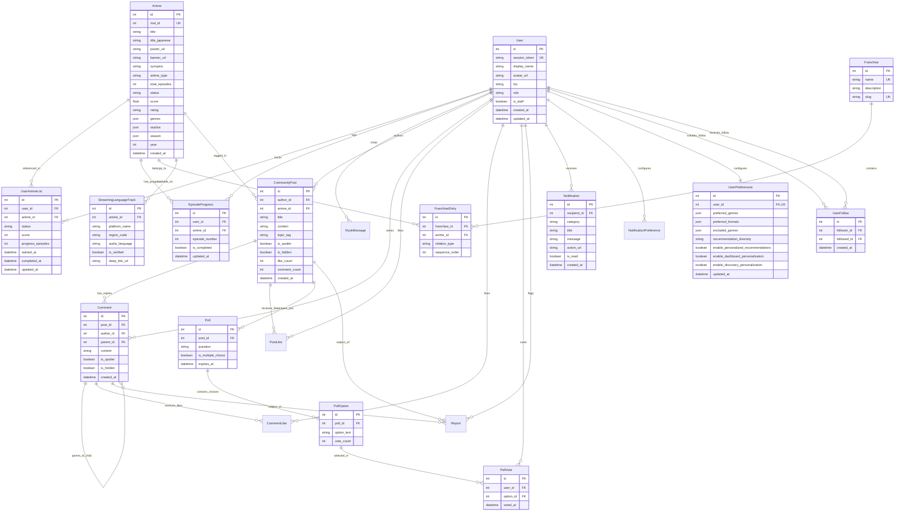

# AnimeVerse AI — Database Architecture & Schema Specification

This document details the relational database design, entity relationships, model specifications, and storage configurations of **AnimeVerse AI**.

---

## 1. Storage Engines & Environment Strategy

AnimeVerse AI supports a dual-engine architecture:

| Environment | Database Engine | Configuration | Use Case |
|---|---|---|---|
| **Local Development** | SQLite 3 | Write-Ahead Logging (`PRAGMA journal_mode=WAL;`), foreign keys enabled | Rapid local prototyping with zero external dependency |
| **Testing / CI** | SQLite 3 | In-memory / isolated file database (`--keepdb` supported) | Fast, isolated automated regression suites |
| **Staging / Production** | PostgreSQL 16 | Managed SSL connection pool via `dj-database-url` | High-concurrency production deployments |

---

## 2. Entity-Relationship (ER) Diagram

---

## 3. Core Relational Constraints & Indexing Strategy

1. **Session Resolution**: `User.session_token` carries a unique index (`db_index=True`, `unique=True`) ensuring sub-millisecond session lookup on every inbound request.
2. **Watchlist Uniqueness**: `UserAnimeList` enforces `unique_together = ('user', 'anime')`, preventing duplicate tracking rows per user.
3. **Episode Progress Uniqueness**: `EpisodeProgress` enforces `unique_together = ('user', 'anime', 'episode_number')`, guaranteeing deterministic progress calculations.
4. **Poll Vote Integrity**: `PollVote` enforces `unique_together = ('user', 'option')` and transaction-isolated checks to reject duplicate ballot submissions.
5. **Streaming Language Provenance**: `StreamingLanguageTrack` indexes `('anime', 'platform_name', 'region_code')` to rapidly resolve territory-specific licensing queries.
6. **User Preferences Isolation**: `UserPreferences` enforces strict OneToOne cardinality with `User` (`OneToOneField(User, related_name='preferences')`), providing secure, isolated personalization controls per user session.
7. **Follow Relationship Uniqueness & Performance**: `UserFollow` enforces `UniqueConstraint(fields=['follower', 'followed'], name='unique_user_follow_pair')` to reject duplicate follow links and self-following, while indexing `follower_id` and `followed_id` for efficient following feed queries and count aggregations.
8. **Watchlist Query & Invalidation Indexing (Phase 14)**: `UserAnimeList` defines compound indexes:
   - `user_anime_status_idx`: `('user', 'status')` for rapid watchlist status filtering.
   - `user_anime_updated_idx`: `('user', '-updated_at')` for sub-millisecond cache version checks and recent activity ordering.
   - `anime_status_idx`: `('anime', 'status')` for anime-centric engagement calculations.
9. **Community Feed Indexing (Phase 14)**: `CommunityPost` defines compound indexes:
   - `comm_post_hidden_created_idx`: `('is_hidden', '-created_at')` for main feed pagination without full table scans.
   - `comm_post_cat_created_idx`: `('category', '-created_at')` for category-specific feed queries.
   - `comm_post_anime_created_idx`: `('anime', '-created_at')` for anime detail discussion feeds.
   - `comm_post_user_created_idx`: `('user', '-created_at')` for user profile post histories.
10. **Comment & Discussion Hierarchy Indexing (Phase 14)**: `Comment` defines compound indexes:
    - `comm_comment_post_idx`: `('post', 'is_hidden', 'created_at')` for thread reply fetching.
    - `comm_comment_parent_idx`: `('parent', 'created_at')` for nested reply trees.
11. **Review Query Indexing (Phase 14)**: `Review` defines compound indexes:
    - `rev_anime_hidden_created_idx`: `('anime', 'is_hidden', '-created_at')` for anime review listings.
    - `rev_user_created_idx`: `('user', '-created_at')` for user profile review history.
